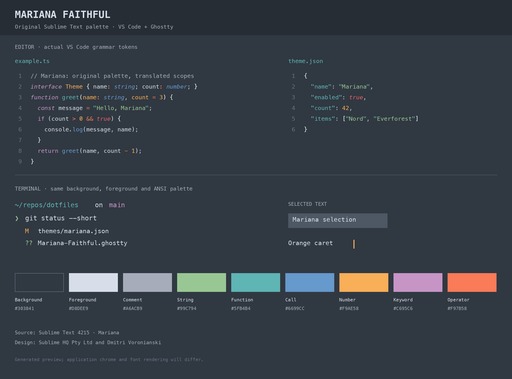
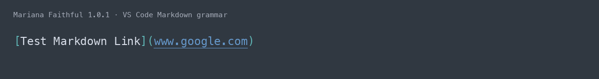

# Mariana Faithful

A port of Sublime Text’s Mariana color scheme for **VS Code** and **Ghostty**,
with the original blue-gray background, orange caret, and muted syntax palette.



The port preserves details that can disappear in conversions: teal function
names at declarations, blue function calls, orange parameters, and coral
operators. Markdown links keep normal-colored labels, teal delimiters, and blue
underlined URLs:



These are generated palette previews using real VS Code grammar tokens, rather
than application screenshots. The original design is by **Sublime HQ Pty Ltd
and Dmitri Voronianski**. Mariana Faithful is an unofficial port.

## Install in VS Code

1. Download the `.vsix` from [GitHub Releases](https://github.com/ronlipke/mariana-faithful/releases),
   or build it from source below.
2. Open the Command Palette: **Cmd-Shift-P** on macOS or **Ctrl-Shift-P** on
   Windows/Linux.
3. Run **Extensions: Install from VSIX…** and select the downloaded file.
4. Run **Preferences: Color Theme** and select **Mariana Faithful**.

The extension also supplies matching colors for VS Code’s integrated terminal.
Its ID remains `ron-local.mariana-faithful` to support upgrades from the initial
local package. Installation from a VSIX does not require a Marketplace account.

## Install in Ghostty

Download `Mariana-Faithful.ghostty` from this repository or a release. In your
Ghostty configuration, set its absolute path:

```ini
theme = /absolute/path/to/Mariana-Faithful.ghostty
```

On macOS, **Cmd-,** opens the configuration and **Cmd-Shift-,** reloads it.
On Linux, edit your Ghostty configuration and reload with **Ctrl-Shift-,**.
An absolute theme path avoids writing custom files into Ghostty’s bundled themes.

Explicit `background`, `foreground`, `palette`, `cursor-*`, or `selection-*`
settings in your Ghostty configuration override theme values. An opaque
background gives the closest match to Sublime’s editor.

## Fidelity and adaptations

- The source is `Mariana.sublime-color-scheme` from Sublime Text **build 4215**.
  The resolved colors and source URL are in [palette.json](palette.json).
- VS Code semantic highlighting defaults off so language servers do not override
  the grammar colors. Optional semantic mappings are included for users who
  enable it. Explicit user settings take precedence.
- The port includes Markdown-specific scope mappings for link labels, URLs,
  reference links, and image descriptions.
- Mariana defines an editor color scheme, not an ANSI terminal palette or a
  complete application interface. The terminal palette and subdued workbench
  chrome are adaptations using the source colors.
- Most bright ANSI slots reuse the normal color to avoid an oversaturated second
  palette. Selection is flattened to `#4D5864` in Ghostty to match Sublime’s
  translucent selection over `#303841`.
- Shell plugins, programs emitting 24-bit colors, and the fixed 256-color cube
  can use colors independently of the terminal’s 16-color palette.
- Syntax grammars and font rendering differ between applications. Sublime-only
  token backgrounds and foreground adjustments have no complete VS Code equivalent.

## Build and test

Requires **Node.js 22 or newer** and npm. No Sublime Text installation is needed.

```sh
npm ci
npm run build
npm test
npm run package
```

The package is written to `dist/mariana-faithful-1.0.2.vsix`. Generated packages,
reports, dependencies, and grammar caches are ignored by Git.

- Edit `vscode/themes/mariana-faithful-color-theme.json` for syntax and workbench
  colors. It is the canonical VS Code theme source.
- Edit `palette.json` for the shared terminal palette. `npm run build` generates
  the Ghostty file and synchronizes VS Code’s terminal colors and license notices.
- `npm test` uses the real VS Code grammar engine across TypeScript, Python,
  JSON, YAML, shell, HTML, CSS, and Markdown. Color regressions cover declarations,
  calls, parameters, punctuation, strings, and the Markdown-link correction.
- Grammar downloads are pinned to the VS Code revision recorded in
  `tests/grammar-sources.json`. The first test run needs internet access;
  subsequent runs reuse `.cache/`. Test results are written to `build/`.
- If Ghostty is installed, you can additionally run
  `ghostty +validate-config --config-file=Mariana-Faithful.ghostty`.

## License and attribution

The original porting implementation and adaptations are released under the
[MIT license](LICENSE.txt). Original Mariana design and third-party provenance
are credited in [NOTICE.md](NOTICE.md). This is not an official Sublime HQ product.
