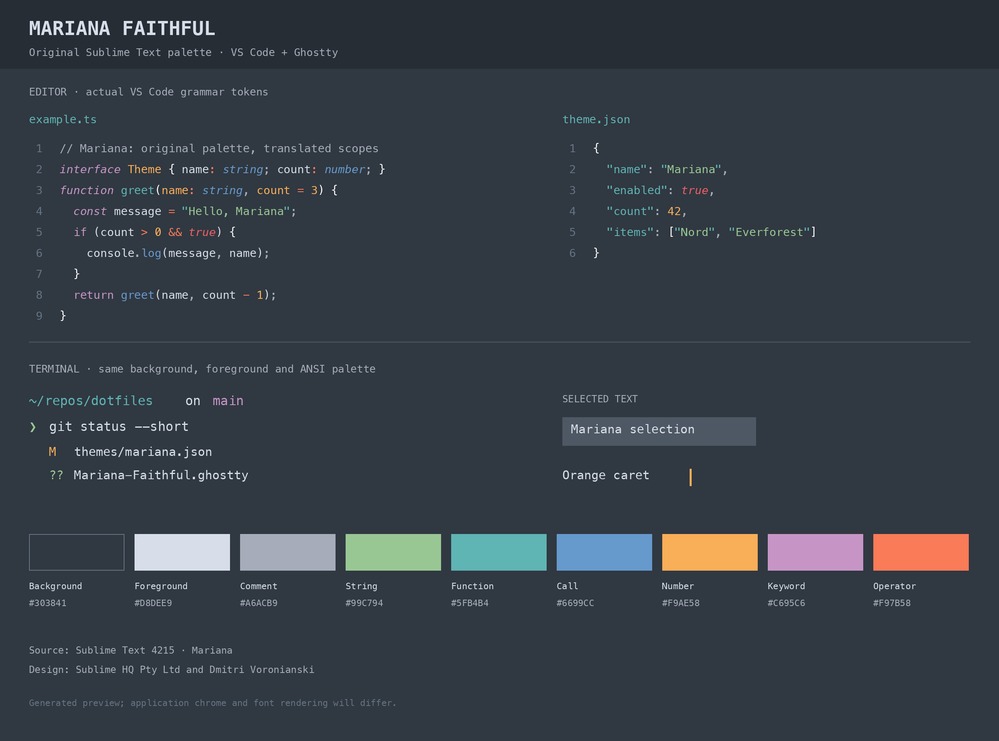
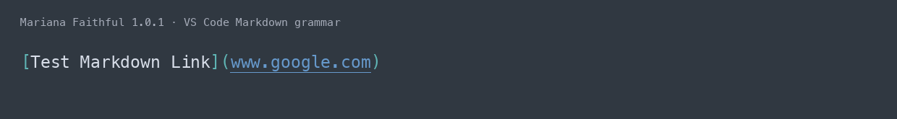

# Mariana Faithful

Sublime Text’s Mariana color scheme, brought to VS Code with its original
blue-gray background, orange caret, and muted syntax colors.

*Generated preview using VS Code’s syntax grammars. Font rendering and application
chrome may differ from your setup.*

## The details matter

Mariana Faithful preserves the distinctions that give Mariana its character:

- **Teal function declarations** and **blue function calls** where the language
  grammar distinguishes them.
- **Green strings**, **orange numbers and parameters**, **pink keywords**, and
  **coral operators**.
- **Muted comments** with the original nonitalic styling.
- **Normal-colored Markdown link labels**, teal delimiters, and blue underlined
  URLs, including mappings for reference links and image descriptions.
- A coordinated workbench and matching colors for VS Code’s integrated terminal.

## Activate the theme

1. Install **Mariana Faithful** from the Extensions view.
2. Open the Command Palette with **Cmd-Shift-P** on macOS or **Ctrl-Shift-P** on
   Windows/Linux.
3. Run **Preferences: Color Theme** and choose **Mariana Faithful**.

You can also install a VSIX from [GitHub Releases](https://github.com/ronlipke/mariana-faithful/releases)
using **Extensions: Install from VSIX…**.

## Matching Mariana

The palette comes directly from the Mariana scheme shipped with Sublime Text
build 4215. Scope mappings are adapted for VS Code’s syntax grammars.

Semantic highlighting defaults off to preserve these grammar-based colors.
Mappings are also included if you prefer to enable semantic highlighting.
Explicit user settings and color customizations take precedence over the theme.

The workbench and terminal palette extend Mariana’s colors to areas without a
direct Sublime equivalent. Syntax grammars, language extensions, and font
rendering can produce differences between editors; some Sublime-specific
highlighting effects have no equivalent in VS Code.

## Ghostty companion

Use the matching [Ghostty theme](https://github.com/ronlipke/mariana-faithful#install-in-ghostty)
for the same palette in your standalone terminal.

## Feedback

Found a mismatch? [Open an issue](https://github.com/ronlipke/mariana-faithful/issues)
with the language, a small code sample, and screenshots of the original Mariana
scheme and this theme.

## Credits and license

Original Mariana design: **Sublime HQ Pty Ltd and Dmitri Voronianski**.
This is an unofficial port, with no affiliation or endorsement from Sublime HQ.

The original porting implementation and adaptations are [MIT-licensed](https://github.com/ronlipke/mariana-faithful/blob/main/LICENSE.txt).
See the [attribution notice](https://github.com/ronlipke/mariana-faithful/blob/main/NOTICE.md)
for source details and third-party credits.
